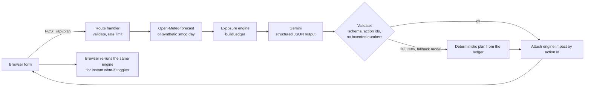

# Saans (साँस): a smog-season planner for families and communities

Saans turns live air-quality data into a day plan for a specific household, then shows, in numbers from a transparent model, how much each choice cuts the PM2.5 that household breathes in. Built for **PromptWars Virtual, Challenge 6: Urban Air Quality Assistant**.

> **The engine calculates, Gemini reasons.** All impact figures come from a deterministic exposure engine. Gemini chooses and explains actions in plain language, but it is never allowed to write a number: the server rejects any model output that contains its own impact figures and attaches the engine's figures by action id.

## Problem statement alignment

| Clause in the brief | Where it shows up | Code | Tests |
| --- | --- | --- | --- |
| Families and communities | Household profile (child, older adult, respiratory condition) plus a community idea in every plan (neighbours, RWA, school, shared clean room) | `src/components/HouseholdForm.tsx`, system instruction rule 11 in `src/lib/gemini.ts` | `tests/gemini.test.ts` |
| Low-emission daily routines | Hour-by-hour timeline: move outdoor time, mask for unavoidable exposure, metro/bus commute | `src/engine/actions.ts`, `src/components/PlanView.tsx` | `tests/engine.test.ts`, `tests/fallbackPlan.test.ts` |
| Indoor air quality hacks | Keep windows closed in bad hours, run an owned purifier, or build a DIY box-fan filter on a low budget | `src/engine/actions.ts` (`close_windows`, `run_purifier`, `diy_filter`) | `tests/engine.test.ts`, `tests/planService.test.ts` |
| Sustainable alternatives | Commute swap with CO₂e effect; Gemini adds further swaps (shared transport, community actions) | `src/engine/actions.ts` (`swap_commute`), `sustainableSwaps` in `src/lib/schemas.ts` | `tests/engine.test.ts` |
| Tailored to location and lifestyle | Place search or geolocation drives a live 3-day PM2.5 forecast; commute, windows, purifier, budget, routine change the plan | `src/lib/airQuality.ts`, `src/lib/context.ts`, `src/lib/planService.ts` | `tests/airQuality.test.ts`, `tests/planService.test.ts` |
| Clearly explaining the direct impact of choices | **Exposure ledger**: baseline vs planned day with ranges, per-action contribution, instant what-if toggles, and an assumptions table tagged "assumption" or "sourced" | `src/engine/ledger.ts`, `src/components/LedgerPanel.tsx` | `tests/engine.test.ts`, `tests/planValidation.test.ts` |

Winter smog hits the Indo-Gangetic Plain hardest, so the demo personas are a Delhi family with an asthmatic child and an elderly couple in Lucknow. English and Hindi are supported end to end.

## How it works



- `src/engine/`: pure TypeScript physics-style model (indoor mass balance, breathing rates, CPCB bands). Runs on the server for the plan and in the browser for what-if toggles.
- `src/lib/gemini.ts`: system instruction, schema-constrained call, retry with corrective feedback, fallback model. Model IDs come from the environment, never from code.
- `src/lib/planValidation.ts`: rejects invalid JSON, wrong shape, unknown action ids, links or markup, and any `%`, µg, gram or CO₂ figure written by the model.
- `src/lib/fallbackPlan.ts`: if Gemini is unavailable or fails validation, a rule-based plan built only from the ledger is shown and clearly labelled "AI unavailable".
- **AI trace** drawer in the UI shows the exact structured input sent to Gemini, the system instruction, every attempt, and the raw responses.

## Run it

```powershell
npm ci
copy .env.example .env.local   # then add GEMINI_API_KEY, GEMINI_MODEL, GEMINI_FALLBACK_MODEL
npm run dev                    # http://localhost:3000
```

Without a key the app still works: live air data and the exposure ledger are real, and the plan comes from the labelled rule-based fallback.

Get a free key at [Google AI Studio](https://aistudio.google.com) and copy current model IDs from there. Verified working on 24 Nov 2026: `GEMINI_MODEL=gemini-2.5-flash` (about 5 s per plan with thinking disabled) and `GEMINI_FALLBACK_MODEL=gemini-3.1-flash-lite`. Newer preview models returned HTTP 503 "high demand" at the time, which is exactly what the fallback chain is for. Never commit the key; `.env*` is git-ignored. On Vercel, set the same three variables in the project's Environment Variables.

```powershell
npm run typecheck && npm run lint && npm test
npm run test:coverage   # coverage report
npm run build
npm run check:size      # repo size guard (event cap is 10 MB)
```

## Data and standards

- Air data: [Open-Meteo Air Quality API](https://open-meteo.com/en/docs/air-quality-api) and geocoding (CC BY 4.0). These are **regional model estimates, not station readings**, and are always labelled that way.
- Bands: India's CPCB National AQI breakpoints for PM2.5, estimated from PM2.5 alone.
- Guideline reference: WHO 2021 (PM2.5 15 µg/m³ over 24 h).
- Every constant the model uses is in `src/engine/constants.ts`, tagged `sourced` (with the source) or `assumption` (with a note), and both tags are shown in the UI under "How this was computed".

## Privacy and security

- Household details are kept in the browser, sent only when a plan is requested (to this server and on to the Gemini API), and are not stored by the app.
- The Gemini key is read server-side only. The browser never talks to Gemini or Open-Meteo directly (CSP `connect-src 'self'`).
- All input is validated with Zod; request bodies are size-limited; free-text notes are stripped of control, zero-width and bidi characters and passed to the model only in a field marked untrusted. Model output is validated before use and rendered as escaped text.
- Per-IP rate limiting and response caching are in-memory, so on serverless hosting they are best-effort per instance.
- Security headers and a strict Content-Security-Policy are set in `next.config.mjs`.

## Accessibility

Landmarks and a skip link, labelled form controls, visible focus, 44 px touch targets, `aria-live` status for async results, the AQI band always given as text plus a distinct shape (colour is never the only signal), a text description and data table for the hourly chart, native `<dialog>` for the AI trace, `lang` switching for Hindi, and reduced-motion support.

## Tests

`npm test` runs the Vitest suite: the exposure engine (band boundaries, monotonic physics, ledger, trade-offs), the Open-Meteo client (timeouts, HTTP errors, malformed JSON, missing hours), Gemini handling with a scripted mock (429, refusal, empty output, invalid schema, invented numbers, timeouts, fallback model), request validation, injection strings, Hindi and emoji input, clean-air days and extreme smog values.

## Known limitations

- Regional model data, not street-level or station readings.
- One main room is modelled; the purifier is assumed to be in the room where people spend their home hours.
- Indoor sources such as cooking are not modelled.
- Commute CO₂e factors, breathing rates and air-exchange rates are assumptions (tagged in the UI) pending citations.
- Not medical advice. The app tells users with breathing difficulty to seek care.
- The synthetic "smog simulator" day is for testing only and is always labelled as simulated.

## AI and tooling disclosure

Gemini (via `@google/genai`) generates the day plan as schema-constrained JSON in English or Hindi. The code was built with Claude Code.
